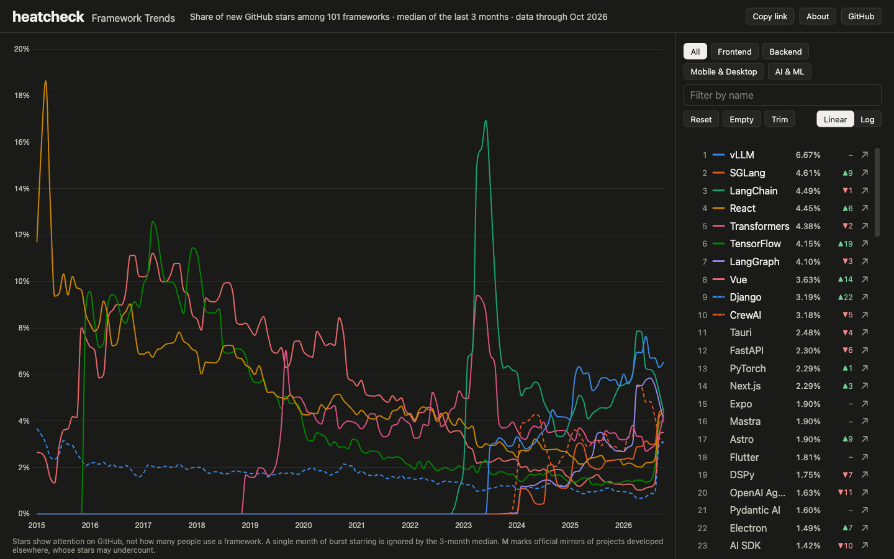

# heatcheck &mdash; Framework Trends

> "In Northeast Ohio, nothing is given. Everything is earned."
> — LeBron James, [_Sports Illustrated_](https://www.si.com/nba/2014/07/11/lebron-james-cleveland-cavaliers) (2014)

**Live site:** https://thanks2music.github.io/heatcheck/

In basketball, a heat check is the shot you take after hitting a few in a row, to find out whether you are really on fire. This site runs the same test on software frameworks: which ones are getting attention right now, and which ones have cooled off.

Pick up to ten frameworks across web frontend, web backend, mobile and desktop, and AI and ML, and compare how their share of new GitHub stars has moved since 2015.



## What you can do

- Compare up to ten of 101 frameworks, from 2015 to last month
- Filter the list by category, or search it by name
- Switch the y axis between linear and log
- Share the view: the address bar always holds a permalink
- See each framework's rank, its share last month, and how its rank moved over the past year

## How to read the chart

The y axis is **each framework's share of new stars**. For every month, heatcheck counts the stars each framework's GitHub repository gained, takes the median of the last three months, and divides it by the sum of those medians across all listed frameworks.

- **Stars measure attention, not use.** A star means someone on GitHub noticed a project. It says nothing about how many teams run it in production, and it leans toward what is new and talked about.
- **Bursts are dampened, not removed.** Stars sometimes arrive in bursts: a launch, a viral post, or a fake-star campaign ([a 2024 study](https://arxiv.org/abs/2412.13459) found these rising, especially around AI/LLM repositories). The three-month median ignores a single burst month, but two burst months in a row still show.
- **Shares are relative to this list.** Adding or removing a framework changes everyone else's share a little.
- **Removed stars disappear from history.** A repository's weekly counts add up to its current star count, so a star that is later removed no longer shows in the month it was given.
- **Mirrors undercount.** WordPress and Qt are developed outside GitHub and only mirrored there, so fewer people star them. They are marked **M**.
- **Some frameworks use more than one repository.** Vue (`vuejs/core` and `vuejs/vue`) and Laravel (`laravel/laravel` and `laravel/framework`) add up both, so someone who starred both counts twice.
- **Rank change compares last month with the same month a year earlier.** "new" means the framework had no stars a year ago.

## Where the data comes from

Star counts come from GitHub's [star history endpoint](https://docs.github.com/en/rest/activity/starring?apiVersion=2026-03-10#get-repository-star-history), `GET /repos/{owner}/{repo}/stargazers/history`, which returns stars per day, a week at a time, back to the week each repository was created. The raw weeks are stored in [`data/stars/`](data/stars), one file per repository.

The list of frameworks lives in [`data/frameworks.ts`](data/frameworks.ts). To add one, append an entry with its canonical GitHub repository (`gh api repos/OWNER/REPO --jq .full_name`), run `bun run update-data` to fetch its history, and open a pull request. The rules for what qualifies are at the top of that file.

## Keeping the data fresh

The [Update data](.github/workflows/update-data.yml) workflow runs on the 3rd of every month, fetches the latest weeks, builds the site, and opens a pull request. Select **Approve workflows to run** on that pull request (pull requests created with `GITHUB_TOKEN` wait for approval), check the result, and merge to deploy.

Things to know:

- The workflow needs the repository setting **Allow GitHub Actions to create and approve pull requests**.
- To run it now: `gh workflow run update-data.yml --repo thanks2music/heatcheck`.
- GitHub disables scheduled workflows in a public repository after 60 days without activity. If that happens, the header starts saying "may be out of date" three months after the last data month. Re-enable the workflow with `gh workflow enable update-data.yml --repo thanks2music/heatcheck`.
- A monthly run fetches only recent weeks. To refetch every repository's full history, run `GH_TOKEN=$(gh auth token) bun run update-data --full` locally.

## Development

Requires [Bun](https://bun.sh/) (the version is pinned in `package.json`).

```sh
bun install
bun run dev          # dev server with the current data
bun run update-data  # fetch new weeks into data/stars/ (set GH_TOKEN for a higher rate limit)
bun run build        # derive the chart data and build dist/
bun run preview      # serve dist/ at http://localhost:4173/heatcheck/
bun test
bun run typecheck
bun run lint
```

Merging to `main` deploys the site to GitHub Pages.

## Credits

- Inspired by [Languish](https://github.com/tjpalmer/languish) by tjpalmer, which charts programming languages the same way
- Data: [GitHub REST API](https://docs.github.com/en/rest/activity/starring)
- Built with [Preact](https://preactjs.com/), [Chart.js](https://www.chartjs.org/), [Zod](https://zod.dev/) and [Bun](https://bun.sh/)
- Line colors: a palette checked for color-vision deficiency on a dark background

## License

[MIT](LICENSE)
